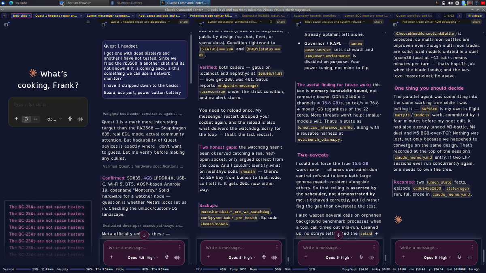

# Claude Command Center

A tiled, multi-session desktop shell for claude.ai — one window, many logged-in
chats, your own chrome instead of fighting the OS window manager.



[](https://github.com/frankstupak/claude-command-center/actions/workflows/ci.yml)
[](LICENSE)
[](CHANGELOG.md)

## Quick start

```bash
git clone https://github.com/frankstupak/claude-command-center.git
cd claude-command-center
npm install
npm start
```

Sign in once in any tile — the login is shared across every tile
(`persist:claude` partition).

## Features

- **One `BaseWindow`, N `WebContentsView` tiles**, all sharing a single login.
- **`+` spawns a chat.** Columns are decided by width: `floor(width / 470px)`.
  Maximized on a ~1080p laptop ≈ 4 tiles. Shrink to half-width → 2 tiles.
- **Slider paging.** More chats than columns? The `‹ n–m/total ›` pager (or
  `Ctrl+←/→`) scrolls the row.
- **MRU auto-priority.** Jump into an off-screen chat and it pulls to the
  front so it lands on screen. Visible tiles don't shuffle under you
  (`REORDER_MODE` in `config.js` — `offscreen-only` default, `always`, or
  `off`).
- **Resumes on restart.** Open tabs and their order are saved continuously
  and restored. Close a chat only when you close it.
- **Margins killed, tables tamed.** Injected CSS drops claude.ai's max-width
  gutter and makes wide tables scroll in-box instead of running off-page.
- **Unified bottom bar.** Session / Weekly / Fable usage in one thin strip,
  refreshed on prompt completion.
- **Native automations** (no extensions to install):
  - Auto-Continue — clicks the *Continue* button, with a per-turn chain cap.
  - Session-resume — on a limit banner, waits out the reset, then resumes
    after a random `45–210s` jitter.
  - Usage capture — feeds the bottom bar.
- **Shortcuts:** `Ctrl+T` new · `Ctrl+W` close active · `Ctrl+1..9` jump to
  tile · `Ctrl+←/→` page.
- **Optional ntfy ping** when a background tile finishes (`NTFY_TOPIC_URL`).

## How it works

```
BaseWindow
├── topbar      WebContentsView  (our UI: + , chips, pager, sidebar toggle)
├── bottombar   WebContentsView  (our UI: usage bar)
└── tile ×N     WebContentsView  (claude.ai, shared persist:claude session)
                └── inject: styles.css  +  automations.js (main world)
                    bridged to main by preload-view.js (isolated world)
```

Selectors in `styles.css` / `automations.js` are attribute/text based and
fail soft — a claude.ai markup change no-ops a rule, it never breaks the
page.

## Building a distributable

```bash
npm run dist        # -> AppImage + .deb in dist/
```

## Not wired yet

- Broadcast-prompt (type once → send to selected tiles) for parallel agent
  runs.
- Double-click a tile to solo/zoom it full-shell.
- Per-tile working/idle dot.
- Saved layout presets.

## Docs

- [CHANGELOG.md](CHANGELOG.md)
- [CONTRIBUTING.md](CONTRIBUTING.md)
- [SECURITY.md](SECURITY.md)

## Contributing

Issues and PRs welcome — see [CONTRIBUTING.md](CONTRIBUTING.md) for the
branch/commit conventions this repo uses.

## License

[MIT](LICENSE)
